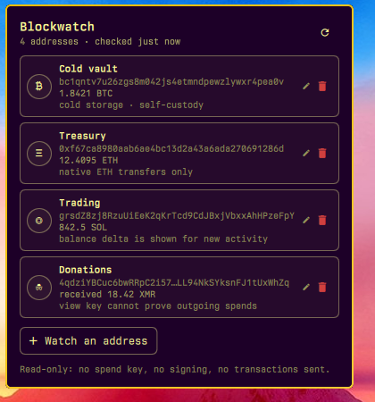

<p align="center">
  
</p>

# Blockwatch

A read-only address watcher for the Omarchy bar. Blockwatch watches BTC, LTC,
DOGE, ETH, SOL and XMR addresses and tells you when an address is credited or
debited. It is not a wallet: it holds no spend key, cannot sign, and never
sends a transaction.

<p align="center">
  
</p>
<p align="center"><sub>Fictional demo data, captured with <code>demo/run</code>.</sub></p>

## What it does

- Adds a small eye to the bar. It glows while there are unseen events.
- Checks the watch list on a timer (default every 120 seconds) and on network
  reconnect.
- Sends a desktop notification for new credit or debit activity.
- Shows each watched address, its native balance (or, for Monero, the amount
  received), the last event and any provider error in a panel.
- Edits a live watch in place: click its row to change the label, address,
  Monero server or view key without deleting and re-adding it.
- Remembers custom XMR light-wallet servers in a dropdown beside the built-in
  public LWS and local `monero-wallet-rpc` options.
- Keeps its own state so a restart does not re-notify old history. The first
  successful check of a new address is a silent baseline.
- Runs one headless service for the whole shell, so a bar on four monitors
  still makes one provider call per interval and one notification per event.

## Chains and providers

| Chain | Provider | Notes |
| --- | --- | --- |
| BTC | [mempool.space](https://mempool.space) | Public transactions; no key needed. |
| LTC | [litecoinspace.org](https://litecoinspace.org) | mempool.space-compatible API. |
| DOGE | [BlockCypher](https://www.blockcypher.com) | Free tier; an API token can be configured. |
| ETH | [Blockscout](https://eth.blockscout.com) | Native ETH transfers only; tokens are not followed. |
| SOL | Solana JSON-RPC | Public signatures and balance; no key needed. |
| XMR | [monero-lws](https://github.com/vtnerd/monero-lws) or `monero-wallet-rpc` | Needs the private **view** key. See below. |

The endpoint for one address can be overridden in the config file, so a
different Blockscout instance (Base, Optimism, Gnosis, …), a private Solana
RPC, or a self-hosted light wallet server can be used without code changes.

## Install

```bash
omarchy plugin add https://github.com/ekollof/blockwatch.git
omarchy plugin enable io.github.ekollof.blockwatch
omarchy bar put io.github.ekollof.blockwatch --section right
```

Saving a file in the installed plugin reloads it. `omarchy plugin validate`
checks the manifest; `omarchy agent look plugin` renders the bar icon.

## Add an address

Click the eye, choose **Watch an address**, pick the chain and paste the
public address. A label is optional. **Click a row to edit its label,
address, server or Monero mode**; the trash button stops watching it.

The same operations are available without the UI:

```bash
BW=~/.config/omarchy/plugins/io.github.ekollof.blockwatch/bin/blockwatch

$BW add --chain btc --address bc1q... --label "Cold storage"
$BW add --chain eth --address 0x... --label "Treasury"
$BW add --chain doge --address D...   # set BLOCKWATCH_API_KEY first
$BW list
$BW update btc:bc1q... --label "Deep cold storage"
$BW update btc:bc1q... --address bc1q... --label "Replaced device"
$BW remove btc:bc1q...
$BW poll | jq .
```

An update keeps a stored Monero view key unless you pass a new `--view-key`,
so changing only the label or server does not make you paste the key again.
Changing the address or chain drops the old key and asks for the one that
belongs to the new target.

For scripts and the panel, secrets are better passed through the environment
than through argv, where `ps` and shell history can see them:

```bash
read -rsp "View key: " BLOCKWATCH_VIEW_KEY; echo; export BLOCKWATCH_VIEW_KEY
read -rsp "API key: " BLOCKWATCH_API_KEY; echo; export BLOCKWATCH_API_KEY
read -rsp "RPC user: " BLOCKWATCH_RPC_USER; echo; export BLOCKWATCH_RPC_USER
read -rsp "RPC password: " BLOCKWATCH_RPC_PASSWORD; echo; export BLOCKWATCH_RPC_PASSWORD
```

`read -s` keeps the value out of the terminal and shell history; a secret
manager's `lookup` command is another good source. The `--view-key`,
`--api-key`, `--rpc-user` and `--rpc-password` flags remain for one-off
commands, but they are visible in `ps` and shell history. The panel passes the
view key to its helper through `BLOCKWATCH_VIEW_KEY`, never as an argument.

Environment API/RPC credentials apply when **adding** a watch. An `update` does
not reapply a global `BLOCKWATCH_API_KEY`/`BLOCKWATCH_RPC_*` to a changed
endpoint: pass the new provider's credential explicitly with `--api-key` /
`--rpc-user` / `--rpc-password` (or edit the `0600` config), so a token chosen
for one provider cannot follow an endpoint change to another.

Custom XMR servers are remembered automatically when a watch using one is
saved. They can also be managed directly:

```bash
$BW servers
$BW server add --label "Home LWS" --endpoint https://lws.example.org
$BW server remove https://lws.example.org
```

The helper stores its watch list in `~/.config/blockwatch/config.json`
(`$XDG_CONFIG_HOME/blockwatch/config.json`) and its state in
`~/.local/state/blockwatch/state.json`
(`$XDG_STATE_HOME/blockwatch/state.json`). Both are created with mode `0600`,
and the directories with `0700`, because a Monero view key is a secret.

## Monero: what actually works

**An XMR address cannot be watched on its own.** Monero replaces the recipient
address with a one-time stealth address and hides amounts with RingCT, so no
block explorer can list "the transactions of address 4…". Public `monerod`
nodes — including the lists at monerodevs.org and Cake Wallet's public nodes —
serve blocks and transactions, not an address index.

There are two honest ways to watch an XMR address, and Blockwatch supports
both:

### 1. A light wallet server (default)

A light wallet server scans the chain with your **private view key** and
returns your incoming history. It never gets a spend key. Blockwatch uses the
MyMonero/monero-lws REST API:

- Default server: `https://lws.monero.fail` (community-run; review its
  operator before trusting it with a view key).
- The add form offers a **server dropdown**: the community LWS, a local
  `monero-wallet-rpc`, or **Custom server…**. A custom URL is remembered in
  the config's `servers` list and appears next time.
- The server may require the wallet to be registered at
  `https://lws.monero.fail/register` (email + public address + view key). If
  the server does not know the wallet, Blockwatch shows a clear error instead
  of pretending the address is quiet.
- Better: run your own `monero-lws` instance and add its URL as a custom
  server.

Get the private view key from the wallet that owns the address (`viewkey` in
`monero-wallet-cli`). Use the wallet's **main address**, which starts with
`4`, not a subaddress that starts with `8`. A view key alone cannot prove
outgoing spends, so the panel labels the number **received** instead of
calling it a balance, and the true balance stays in the spending wallet.

### 2. A local `monero-wallet-rpc`

For the most correct balance and without handing a view key to a third
party, run a view-only wallet locally:

```bash
monero-wallet-cli --generate-from-view-key watch
# enter the main address and private view key when prompted

monero-wallet-rpc \
  --wallet-file watch \
  --daemon-address https://xmr-node.cakewallet.com:18081 \
  --rpc-bind-port 18083 \
  --disable-rpc-login \
  --prompt-for-password
```

Then add the address with:

```bash
$BW add --chain xmr --address 4... --mode wallet-rpc \
  --endpoint http://127.0.0.1:18083/json_rpc
```

The `--daemon-address` can be any trusted public `monerod`. Two that answered
at the time of writing are:

- `https://xmr-node.cakewallet.com:18081`
- `https://node.monerodevs.org:18089`

Those are **daemons**, not watch endpoints: they supply chain data to your
wallet, while the scanning and view key stay on your machine. They are not
valid choices in the XMR server dropdown. A view-only wallet still cannot see
outgoing spends unless key images have been imported, so its balance can be too
high. Blockwatch says so in the row.

### What about an address starting with 8?

Addresses starting with `8` are subaddresses. They belong to the same wallet
account as its main `4…` address. Register the main address and its view key;
the light wallet server scans the account's subaddresses too, and Blockwatch
reports the account-level activity.

## Configuration

The panel covers the common case. The config file exposes the rest:

```json
{
  "version": 1,
  "addresses": [
    {
      "id": "btc:bc1qexample",
      "chain": "btc",
      "address": "bc1qexample",
      "label": "Cold storage",
      "endpoint": "https://mempool.space"
    },
    {
      "id": "xmr:4example",
      "chain": "xmr",
      "address": "4example",
      "label": "Donations",
      "mode": "lws",
      "endpoint": "https://lws.example.org",
      "viewKey": "64-hex-private-view-key"
    },
    {
      "id": "xmr:4example2",
      "chain": "xmr",
      "address": "4example2",
      "mode": "wallet-rpc",
      "endpoint": "http://127.0.0.1:18083/json_rpc",
      "authUser": "optional",
      "authPass": "optional"
    }
  ],
  "servers": [
    {
      "id": "https://lws.example.org",
      "label": "Home LWS",
      "endpoint": "https://lws.example.org",
      "mode": "lws",
      "custom": true
    }
  ]
}
```

The built-in server list is `lws.monero.fail` and the local
`monero-wallet-rpc`; `servers` holds only the custom endpoints Blockwatch
remembered. `id` is the endpoint for a remembered custom server.

Per-address keys:

| Key | Meaning |
| --- | --- |
| `chain` | One of `btc`, `ltc`, `doge`, `eth`, `sol`, `xmr`. |
| `address` | The public address. |
| `label` | Optional display name, at most 80 characters. |
| `endpoint` | Optional provider override. HTTPS required, except loopback for wallet RPC. |
| `viewKey` | Monero private view key (64 hex). Required for `lws`, not for `wallet-rpc`. |
| `mode` | Monero only: `lws` or `wallet-rpc`. |
| `apiKey` | Optional BlockCypher token (or a bearer token for a Solana RPC). |
| `authUser`, `authPass` | Optional basic auth for `monero-wallet-rpc`. |

Keep `id` consistent with `chain:address`; the helper recomputes it when
loading. Quotes and control characters in labels are displayed as plain text
and are never interpreted as markup.

Widget settings live in the normal Omarchy entry (`omarchy bar set`):

| Setting | Default | Range |
| --- | --- | --- |
| `refreshIntervalSec` | 120 | 30–3600 |
| `notify` | `true` | boolean |

## Notifications and state

- The first check of an address stores a baseline and does not notify.
- A transaction id that was not in the state produces one event. A change in
  balance with no new transaction (an internal transfer, or a chain whose
  detail is not public) produces one balanced-change event.
- Monero light wallet servers report *received* totals; Blockwatch does not
  turn that into a spendable balance.
- Solana exposes signatures but not recipient amounts through the cheap RPC
  call, so a single new signature is shown with the **net balance delta**; a
  burst is shown as activity.
- Blockwatch caps a report at 25 events per address and notifies for at most
  three plus a summary, so a very busy exchange address cannot flood the
  desktop.

## Privacy and security

- **Read-only by construction.** No spend key, no seed, no signing, no
  broadcast, no send/receive UI. Monero uses the private *view* key, which
  can only reveal incoming payments.
- No telemetry, analytics or crash reporting. Outbound requests go only to the
  provider or server shown for each watched address.
- Transparent chains are queried by address at the provider listed above.
  That reveals which addresses you care about to that provider. Use your own
  endpoint if that matters to you.
- A Monero view key is sent only to the configured light wallet server (or
  stays local with `wallet-rpc`). Treat a third-party LWS as you would any
  other service that can see your incoming history.
- Custom XMR server URLs are stored in the config and shown in the form. Do
  not put credentials or tokens in those URLs; `wallet-rpc` has separate
  `authUser`/`authPass` fields for Basic auth.
- HTTPS only; loopback HTTP is allowed only for `monero-wallet-rpc`. Redirects
  cannot change host or scheme.
- Every request has a timeout and a response-size cap; every list and string
  is bounded before display or storage.
- Stopping or editing a watch cancels any in-flight poll before the config
  write. CLI mutations use the same config lock as each address check, so a
  CLI removal also cannot be followed by a request from an older poll.
- Processes are started with argv arrays through omakit's `Run` block, never a
  shell string. QML displays provider and user text with
  `Text.PlainText`.
- Config and state are written atomically with mode `0600`.

## Development

```bash
./tests/run          # stdlib unittest suite, no network
omarchy plugin validate .
mise exec node@26.13.0 -- omakit inspect .
```

The helper is Python 3 standard library only. `bin/blockwatch` is the CLI;
`lib/blockwatch/` holds the provider adapters, validation, state and poll
logic. `BarWidget.qml` is the bar surface and form; `service.qml` is the
headless service that owns the timer, unread count and notifications for all
bar instances. Provider parsers can be tested without network by monkeypatching
`blockwatch.watch.fetch` or the private parser functions.

The README screenshot is generated from committed fictional data, not a live
wallet:

```bash
./demo/run          # temporary fixture helper, restored on exit
```

`demo/fixtures/report.json` is the only data shown; `demo/run` backs up the
installed helper, uses an empty monitor, captures the panel and restores the
real helper/config on exit.

## Limitations

- Native coin only. ERC-20/SPL tokens, NFTs and contract events are not
  followed.
- Polling, not push. The minimum interval is 30 seconds; public APIs may rate
  limit larger watch lists.
- Solana amounts are approximate net balance moves for the single-signature
  case and unknown for bursts.
- The BlockCypher free tier is rate limited; a token is recommended for more
  than a couple of Dogecoin addresses.
- An LWS that has no history for a wallet begins where the server registered
  it. Watching from now on is the normal case; historical backfill is the
  server's business.
- Blockwatch speaks HTTPS directly and does not ship a Tor transport, so the
  onion-only LWS endpoints cannot be selected; use a clearnet LWS you trust or
  a local `monero-lws`.

## Uninstall

```bash
omarchy plugin remove io.github.ekollof.blockwatch --yes
rm -rf ~/.config/blockwatch ~/.local/state/blockwatch
```

## License

MIT. See [LICENSE](LICENSE).
